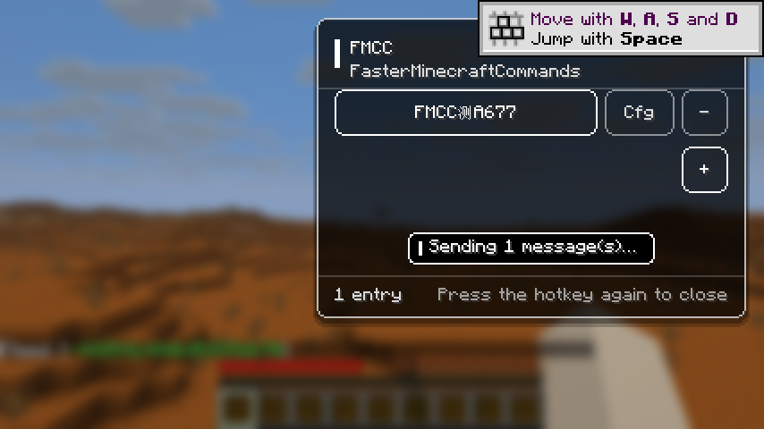

# FasterMinecraftCommands（FMCC）

> 面向 Minecraft **1.21.8 Fabric** 客户端的快捷指令/聊天菜单。按下一个键，在屏幕右侧唤出现代化面板，
> 把常用指令（`/spawn`、`/time set day`、`/tpa ...`）和聊天短语存成条目，一键按顺序发送。

**中文** | [English summary](#english-summary)

---

## 功能

| 功能 | 说明 |
|---|---|
| 快捷键 | 默认 **Tab**，可在「选项 → 控制 → 按键绑定 → FasterMinecraftCommands」中改绑；**再按一次快捷键关闭菜单**（ESC 亦可关闭） |
| 右侧菜单 | 紧凑圆角面板（约屏幕 1/3 宽）、黑色 50% 半透明背景、白色线框按钮、滚动条与内嵌状态提示；不会暂停游戏 |
| 添加条目 | 面板右下角 **+**；必须输入 **1–10 个字**的标题，取消输入则不会创建条目 |
| 一键发送 | 条目主按钮（占整行 **2/3**）显示标题，点击后按顺序发送该条目配置的全部文本 |
| 配置界面 | 每条目独立配置：**+** 添加文本框、文本框右侧 **-** 删除该文本；右上角 **返回** |
| 发送节奏 | 多条文本**从上到下**逐条发送，间隔 **0.75 秒**（15 刻） |
| 指令 / 聊天 | 以 `/` 开头的文本作为**指令**发送（权限与手动输入一致），否则作为聊天消息发送 |
| 未配置文本 | 不会发送，只在面板内提示「该条目未配置文本」 |
| 删除条目 | 每行右侧 **-** 立即删除该条目及其全部配置 |
| 中英双语 | 跟随游戏语言：`en_us` / `zh_cn` |

## 截图

| 主菜单（1.1 紧凑黑底白线框） | 条目配置 |
|---|---|
|  |  |

| 空状态 | 真实世界内发送（中文界面，右侧面板） |
|---|---|
|  |  |

> 截图来自游戏内自动化验收（真实客户端、真实鼠标点击/按键），不是 UI 模拟图；主菜单截图同时展示在
> 40+ 模组整合包（Sodium/Iris/REI/Carpet…）中运行的效果。

## 安装

1. 安装 **Minecraft 1.21.8** + **Fabric Loader 0.17.0+**。
2. 将 [Fabric API](https://modrinth.com/mod/fabric-api)（`0.136.1+1.21.8` 或更高的 1.21.8 版本）放入 `mods/`。
3. 将 `fmcc-1.1.0.jar` 放入 `mods/`。
4. 启动游戏，进入任意世界后按 **Tab**（或你改绑的键）。

> FMCC 是**纯客户端模组**：服务器不需要安装，不会向服务器注册任何内容，也不会影响他人或服务端性能。

## 使用

### 主菜单
- 右侧面板按顺序列出所有条目，一行一个。
- 每行从左到右：**主按钮（2/3 宽，显示标题）**、**配置**、**-**。
- 行下方右对齐的 **+** 用于新建条目（无条目时 + 位于列表顶部）。
- 条目多时可用鼠标滚轮滚动；底部显示条目数与「再按一次快捷键关闭」提示。
- 点击主按钮即可发送；发送队列是全局先进先出，连点多个条目不会交错，仍保持 0.75 秒间隔。

### 新建条目
- 点击 **+** → 居中弹窗输入标题（1–10 字，实时计数，输入超过 10 字会自动截断）。
- **创建** 或回车确认；**取消** 或 ESC 会终止创建，不写入任何数据。

### 配置条目
- 点击条目的 **配置** 进入。样式与主菜单一致，右上角 **返回**（ESC 同样返回）。
- **+** 添加一个文本框；**-** 删除该文本框及其内容。
- 文本按从上到下的顺序发送；每条最多 256 字符（与游戏聊天上限一致）。
- 编辑时只更新内存，**返回 / 关闭界面 / 结构变化 / 退出游戏**时写入 `config/fmcc.json`，
  打字过程不产生磁盘 IO。

## 数据与配置

- 配置文件：`.minecraft/config/fmcc.json`（结构：`version` + `entries[]`，每条含 `id/title/texts`）。
- 文件损坏时会自动备份为 `fmcc.json.corrupt-<时间>` 并以空配置启动，不会崩溃。
- 删除模组后该文件可直接删除，不影响存档。

## 兼容性与性能

- 纯客户端、**零 Mixin**，只使用 Fabric API 稳定事件（按键绑定 / 生命周期 / 连接断开）。
- 已在真实整合包环境（Sodium、Iris、REI、Carpet 系、Axiom、Litematica、Xaero、MaLiLib 等 40+ 模组）中启动验证。
- 渲染仅使用原版 `fill`/文字绘制；渲染循环内无 IO、无每帧大量对象分配；空闲时每刻只有一次队列计数判断。
- 与大多数 GUI 模组共存；不暂停游戏，不抢占键盘输入。

### 关于 Tab 键
原版把 **Tab** 用于「玩家列表」，因此默认绑定会与玩家列表同时触发（菜单照常打开，玩家列表短暂闪现）。
如需完全避免，请在按键绑定中把 FMCC 改为其他键（如 `G`、`V`）。

## 开发者：构建与测试

```powershell
# 环境：JDK 21 + Gradle 8.14.2（本仓库包含可复现的本地构建脚本）
D:\DeepSeek-Harness\FMCC\tools\gradle.cmd build      # 产出 build/libs/fmcc-1.1.0.jar
D:\DeepSeek-Harness\FMCC\tools\gradle.cmd test       # JUnit 5 单元测试（76/76）
D:\DeepSeek-Harness\FMCC\tools\gradle.cmd runClientSelfTest      # 游戏内脚本化验收（标题界面环境）
D:\DeepSeek-Harness\FMCC\tools\gradle.cmd runClientSelfTestWorld # 游戏内脚本化验收（真实单人世界，含真实发送）
```

- 单元测试 **76/76**：标题规则（Unicode 码点/10 字上限）、配置读写/损坏恢复、发送队列节奏（15 刻=0.75 秒）、
  指令路由与 256 字符上限、界面布局几何（2/3 宽度、按钮顺序、+ 右对齐、行列不重叠）等。
- 游戏内自测 **52 步**：真实客户端中通过真实鼠标坐标点击、真实 Tab/ESC 按键驱动完整流程
  （新建/取消/配置/删除/发送），校验几何与数据落盘，输出截图与 `fmcc-selftest-report.json`。
  标题界面环境 50 通过 + 2 设计内跳过；真实单人世界 **52/52 通过**，服务端日志确认 `/seed` 指令真实执行。
- 真实整合包验证（40+ 模组，Sodium/Iris/REI/Carpet/Axiom/Litematica/Xaero…）：同一套 52 步 **0 失败**，
  `tools/LaunchModpackClient.java` 可把构建出的 jar 注入隔离的整合包实例启动并自测。
- 完整证据见 [docs/TEST-REPORT.md](docs/TEST-REPORT.md)，架构与协作说明见 [docs/DESIGN.md](docs/DESIGN.md)，
  代码审查见 [docs/REVIEW.md](docs/REVIEW.md)。

## 目录

```
src/main/java/com/fmcc/
  FmccClient.java        客户端入口：按键、tick、队列、配置存储
  config/                条目模型、JSON 持久化（原子写入、损坏恢复）
  chat/                  发送队列（0.75 秒节奏）、指令/聊天路由
  ui/                    三个界面 + 主题/绘制/按钮/布局工具
  selftest/              游戏内自动化验收
src/main/resources/
  fabric.mod.json        模组元数据（client-only）
  assets/fmcc/icon.png   白底黑字 FMCC 图标
  assets/fmcc/lang/      中英文翻译
```

## English summary

**FasterMinecraftCommands (FMCC)** is a client-side Fabric mod for Minecraft 1.21.8. Press the hotkey
(Tab by default, rebindable) to open a modern right-side panel; create entries with a 1–10 character
title, configure one or more chat messages/commands per entry, and send them top-to-bottom with a
0.75 s gap. Text starting with `/` is sent as a command. Everything is persisted to
`config/fmcc.json`; the mod is client-only, mixin-free and compatible with common modpacks.

## License

MIT — see [LICENSE](LICENSE).

## 更新日志

### 1.1.0（当前）
- 修复标题与配置界面标题的“重影”（去掉伪粗体双重绘制）。
- 界面整体缩小：面板宽度约屏幕 1/3，高度约 55%，窄屏自动收窄。
- 改为黑色 50% 半透明背景；按钮与背景同色，仅用白色线框区分（主按钮线框更亮）。
- 退出方式改为**再按一次快捷键**关闭菜单（ESC 仍保留为备用）。
- 同步更新中英文文案与游戏内自动化验收（53 步，含热键开关菜单）。

### 1.0.0
- 首次发布：右侧菜单、快捷发送指令/聊天、1–10 字标题、配置界面多文本框、0.75 秒顺序发送、中英双语。
